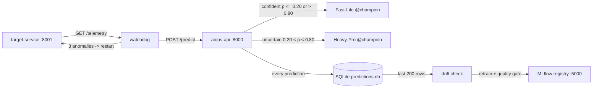

# SentinelRoute

**Self-Healing AIOps & Adaptive MLOps Deployment Platform**

SentinelRoute watches system telemetry, decides whether a machine looks healthy or anomalous, sends uncertain cases to a larger model, restarts a failing service automatically, and retrains when the incoming data changes. It runs with Docker Compose, serves predictions through FastAPI, tracks every model in MLflow, and publishes a container image from GitHub Actions.

If you are new to the project, read [Start here](#start-here), then follow [Quick start](#quick-start). You do not need cloud access for the demo. The rest of the page is reference material; [Troubleshooting](#troubleshooting) is the one section worth skimming before you start.

**Core loop:** `predict -> route -> log -> detect drift -> retrain -> promote -> reload`, with `heal` running alongside it.

## Contents

- [Start here](#start-here)
- [What you need](#what-you-need)
- [Quick start](#quick-start)
- [See it work](#see-it-work-about-3-minutes)
- [Stop, reset, and start again](#stop-reset-and-start-again)
- [How it works](#how-it-works)
- [Models and metrics](#models-and-metrics)
- [Troubleshooting](#troubleshooting)

## Start here

This project demonstrates one complete AIOps loop:

1. **Predict** — a telemetry row (CPU, memory, temperature, and eight more signals) is classified as normal or anomalous.
2. **Route** — a small, fast model handles confident cases. Rows near the decision boundary go to a larger model.
3. **Heal** — if the simulated service reports anomalies three times in a row, a watchdog restarts it and records how long recovery took.
4. **Retrain** — if live traffic drifts away from the training data, the platform retrains, checks the new model, and swaps it in without restarting the API.

The goal is not a perfect score. The goal is a working, auditable loop: every prediction is logged, every model is versioned, every promotion is checked, and every recovery is measured.

### The three services in plain English

| Container | Port | What it does |
| --- | --- | --- |
| `sentinel-api` | `8000` | The prediction service. Receives telemetry, routes it, and returns a result. |
| `sentinel-mlflow` | `5000` | The model filing cabinet. Stores experiments, metrics, versions, and the current champion. |
| `sentinel-target` | `8001` | A fake service that can be made unhealthy, so healing can be demonstrated safely. |

All three are defined in `docker-compose.yml`, so one command starts them together. MLflow is the part that remembers what you trained; the API is the part that answers requests.

## What you need

- **Python 3.11** (3.10 or newer should work, but 3.11 is what CI and Docker use).
- **Docker Engine** on Linux, or **Docker Desktop** on Windows/macOS, with Compose v2.
- **Free ports** `5000`, `8000`, and `8001`.
- About **5–10 minutes** for the first run, mostly image downloads.

If you use a different Python version, replace `3.11` in the Windows `py -3.11` command with your version. The local tests also pass on 3.12.

Check your tools before starting.

**Linux / macOS:**

```bash
python3 --version
docker --version
docker compose version
```

**Windows 11 (PowerShell):**

```powershell
py --version
docker --version
docker compose version
```

If Docker says `permission denied`, add your user to the `docker` group and log out/in, or run the Docker commands with `sudo`.

## Quick start

Run these commands **from the repository root** (the folder containing `README.md` and `docker-compose.yml`).

### Linux / macOS

```bash
# 1. Create and activate a Python environment.
python3 -m venv .venv
source .venv/bin/activate

# 2. Install the Python dependencies used by training and the demo scripts.
pip install -r requirements.txt

# 3. Create the runtime log folder.
mkdir -p logs

# 4. Start MLflow, the API, and the target service in the background.
#    The first build downloads images and can take several minutes.
docker compose up -d --build

# 5. Wait until sentinel-mlflow shows (healthy).
docker compose ps

# 6. Train both models, register them, and promote them.
python -m src.train --promote

# 7. Tell the API to load the promoted models.
curl -X POST http://localhost:8000/reload

# 8. Confirm the API is ready.
curl http://localhost:8000/health
```

### Windows 11 + Docker Desktop

Start Docker Desktop first, then open PowerShell in the repository root:

```powershell
# 1. Create and activate a Python environment.
py -3.11 -m venv .venv
.\.venv\Scripts\Activate.ps1

# 2. Install dependencies.
python -m pip install -r requirements.txt

# 3. Create the runtime log folder.
New-Item -ItemType Directory -Force logs | Out-Null

# 4. Start the stack.
docker compose up -d --build

# 5. Wait until sentinel-mlflow shows (healthy).
docker compose ps

# 6. Train, promote, and reload.
python -m src.train --promote
curl.exe -X POST http://localhost:8000/reload
curl.exe http://localhost:8000/health
```

If PowerShell blocks the activation script, run this once in the same window:

```powershell
Set-ExecutionPolicy -Scope Process -ExecutionPolicy Bypass
```

### What success looks like

If training fails because MLflow was not ready yet, wait for `docker compose ps` to show `sentinel-mlflow (healthy)` and rerun the training step. If it stays unhealthy, inspect `docker compose logs mlflow`.

The final `/health` call should return something like:

```json
{
  "status": "ok",
  "models_loaded": {"fast_lite": true, "heavy_pro": true},
  "alias": "champion",
  "model_versions": {"fast_lite": "1", "heavy_pro": "1"}
}
```

Two things are worth knowing:

- **`503` before training is normal.** The API refuses traffic until both models exist. Run step 6 and step 7 above.
- **`model_versions` may be different** if you have trained more than once. That is also normal; the version number increases.

Open these in a browser when the stack is running:

- **API docs:** `http://localhost:8000/docs` — try endpoints interactively.
- **MLflow UI:** `http://localhost:5000` — inspect runs, metrics, versions, and the `champion` alias.

## See it work (about 3 minutes)

### Step 0 — confirm a clean, loaded stack

**Linux / macOS:**

```bash
curl http://localhost:8000/health
curl http://localhost:8000/stats
```

**Windows 11 (PowerShell):**

```powershell
curl.exe http://localhost:8000/health
curl.exe http://localhost:8000/stats
```

Expected: `status: ok` from `/health`, and all counters at zero from `/stats`.

If `/health` returns `503`, go back to Quick start steps 6 and 7.

### Step 1 — watch the cascade route a borderline row

**Linux / macOS:**

```bash
curl -i -X POST http://localhost:8000/predict \
  -H "Content-Type: application/json" \
  -d @tests/sample_borderline.json
```

**Windows 11 (PowerShell):**

```powershell
curl.exe -i -X POST http://localhost:8000/predict `
  -H "Content-Type: application/json" `
  -d "@tests/sample_borderline.json"
```

PowerShell needs `curl.exe` because the built-in `curl` alias points to `Invoke-WebRequest`. It also needs the payload path in quotes and a backtick for line continuation.

Expected output includes:

```text
X-Model-Route: heavy-pro
"fast_probability": 0.503
"heavy_probability": 0.1941
"prediction": 0
```

**What this proves:** the small Fast-Lite model scored the row at `0.503`, which would cross the `0.50` cutoff and raise a false alarm. Because `0.503` is inside the uncertain band (`0.20 < p < 0.80`), the request was escalated to Heavy-Pro, which scored it `0.1941` and returned `normal`. Confident requests stay on Fast-Lite and never touch the larger model.

### Step 2 — watch the watchdog heal a failing service

Open **two terminals** (or two PowerShell windows), both in the repository root with the virtual environment active.

**Linux / macOS, Terminal 1 — start the watchdog:**

```bash
python -u -m src.ops watchdog
```

**Linux / macOS, Terminal 2 — inject a fault:**

```bash
curl -X POST http://localhost:8001/inject-fault
```

**Windows 11 (PowerShell), Terminal 1 — start the watchdog:**

```powershell
python -u -m src.ops watchdog
```

**Windows 11 (PowerShell), Terminal 2 — inject a fault:**

```powershell
curl.exe -X POST http://localhost:8001/inject-fault
```

Wait about 30 seconds. Terminal 1 should print a streak, then an alert, then a recovery line:

```text
[ALERT] Sustained anomaly detected. Auto-restarting target-service...
[HEALED] recovered=True | MTTR=16.43s
```

Press `Ctrl+C` in Terminal 1 when finished.

**What this proves:** the watchdog noticed three consecutive anomalies, restarted the target container, waited for health to return, and wrote the recovery time to `logs/healing_events.log`. The API and MLflow stayed up because only the target was restarted.

### Step 3 — simulate drift, retrain, and reload

```bash
# Send 60 shifted telemetry rows so the drift check has live data.
python -m src.ops drift --simulate

# Run the KS test. Expect most features to be flagged as drifted.
python -m src.ops drift
```

Expected: a table of features with KS statistics and p-values, followed by:

```text
[drift_check] Drifted features: 11/11
[drift_check] Running local retrain & promotion gate...
[drift_check] API /reload -> 200
```

**What this proves:** live traffic no longer looks like the training data. The platform retrained both models, applied the quality gate, and asked the API to reload the current champions. Drift detection and retraining are automatic once the check is invoked; the demo runs the check manually so you can see each step.

### Step 4 — inspect the evidence

**Linux / macOS:**

```bash
cat logs/healing_events.log
curl http://localhost:8000/stats
```

**Windows 11 (PowerShell):**

```powershell
Get-Content logs\healing_events.log
curl.exe http://localhost:8000/stats
```

You should see one healing event with an MTTR, and non-zero request counters from the demo traffic.

## Stop, reset, and start again

**Stop the stack but keep the trained models and logs:**

```bash
docker compose down
```

**Start it again:**

```bash
docker compose up -d
```

**Reset everything to a brand-new state** (deletes the MLflow volume and the prediction log):

*Linux / macOS:*

```bash
docker compose down -v
rm -f logs/predictions.db logs/healing_events.log
docker compose up -d --build
python -m src.train --promote
curl -X POST http://localhost:8000/reload
```

*Windows 11 (PowerShell):*

```powershell
docker compose down -v
Remove-Item logs\predictions.db, logs\healing_events.log -ErrorAction SilentlyContinue
docker compose up -d --build
python -m src.train --promote
curl.exe -X POST http://localhost:8000/reload
```

`down -v` deletes the MLflow volume, so the next training run starts again at version `1`.

## How it works



1. `src/train.py` trains both models, logs runs and metrics to MLflow, registers versions, and promotes each passing model to its own `champion` alias.
2. `src/api.py` loads both champions at startup and routes each request using the fast model's probability.
3. Every prediction is appended to `logs/predictions.db` for `/stats` and drift analysis.
4. `src/ops.py watchdog` polls the target; a sustained anomaly streak restarts it and records MTTR.
5. `src/ops.py drift` compares recent traffic with the training baseline; enough drift triggers retraining, gating, and a hot reload.

`src/ops.py` also serves the simulated target app (`uvicorn src.ops:target_app`), so the demo fixture stays with the healing code.

### Glossary

| Term | Plain meaning |
| --- | --- |
| **Anomaly** | A telemetry row that looks unhealthy, labelled `1`. Normal is `0`. |
| **Cascade** | Try the cheap model first; escalate uncertain rows to the expensive model. |
| **Champion** | The model version currently approved to serve traffic. It is an MLflow alias, not a separate copy. |
| **Drift** | Live data starts looking different from the data the model was trained on. |
| **Retrain** | Fit new models on current data. |
| **Promotion gate** | Automatic checks a new model must pass before it can become champion. |
| **MTTR** | Mean time to recovery — here, seconds from the first sustained anomaly to a healthy service. |
| **F1** | A single score balancing precision and recall. `1.0` is perfect; `0.0` is useless. |

## For assessment: requirement to evidence

| Requirement | Implementation | Evidence |
| --- | --- | --- |
| FastAPI serving | `src/api.py` | `/predict` returns routed probabilities; `/health`, `/reload`, `/stats` expose lifecycle state |
| MLflow lifecycle | `src/train.py` | Runs, metrics, registered versions, `champion` alias, `eval_report.json` artifact |
| Model quality gate | `src/train.py` | Absolute `F1 >= 0.85`, then beat-or-match the champion; failures stay unaliased |
| Docker | `Dockerfile`, `docker-compose.yml` | Three services: MLflow, API, simulated target |
| CI/CD automation | `.github/workflows/ci.yml` | Tests on every push/PR, GHCR publish on `main`, manual retrain job |
| ML anomaly detection | Fast-Lite / Heavy-Pro forests | Held-out F1 **0.923** (fast) and **0.973** (heavy) on 2,000 rows |
| Multi-model routing | `src/api.py` | `0.20 < p < 0.80` escalates; **12.05%** of held-out traffic uses Heavy-Pro |
| Automated service healing | `src/ops.py watchdog` | 3-anomaly streak restarts the target and logs MTTR |
| Monitoring / retraining | `src/ops.py drift` | Per-feature KS test, `>= 3` drifted features triggers retrain, gate, `/reload` |

## API contract

All endpoints are also documented interactively at `http://localhost:8000/docs`.

| Service | Method | Path | Purpose |
| --- | --- | --- | --- |
| API | `GET` | `/` | Service name and links to docs/health/predict |
| API | `GET` | `/health` | Readiness, `champion` alias, loaded versions |
| API | `POST` | `/predict` | Validated telemetry -> routed prediction |
| API | `POST` | `/reload` | Reload champions after training |
| API | `GET` | `/stats` | Requests, routes, anomalies, average latency |
| Target | `GET` | `/telemetry` | One realistic telemetry sample |
| Target | `GET` | `/health` | Healthy/degraded plus fault flag |
| Target | `POST` | `/inject-fault` | Start emitting anomalous telemetry |
| Target | `POST` | `/clear-fault` | Clear the fault without a restart |

`/predict` returns `prediction`, `status_label`, `probability`, `fast_probability`, `heavy_probability` (null unless escalated), `model_used`, `cascade_triggered`, `latency_ms`, and `timestamp`. The route is also sent as the `X-Model-Route` header.

A minimal request body looks like this:

```json
{
  "cpu_utilization": 30.0,
  "memory_usage": 40.0,
  "disk_io": 12.0,
  "network_latency": 20.0,
  "process_count": 200,
  "thread_count": 700,
  "context_switches": 500,
  "cache_miss_rate": 0.04,
  "temperature": 45.0,
  "power_consumption": 120.0,
  "uptime": 50.0
}
```

## Models and metrics

Both models are random forests over the same 11 raw features. They differ by **capacity**, not just tree count:

| Tier | Configuration | Size | Inference | Role |
| --- | --- | --- | --- | --- |
| Fast-Lite | 40 trees, `max_depth=2`, `max_features=0.5` | ~35 KB | ~0.02 ms/row | Cheap default tier |
| Heavy-Pro | 150 trees, `max_depth=4`, `max_features=0.5` | ~216 KB | ~0.05 ms/row | Resolves the uncertain band |

Training split: 80/20 stratified, `random_state=42`, `class_weight="balanced"`, fixed decision threshold `0.50`.

### How to read the scores

- **Precision** — of the rows flagged as anomalies, how many were really anomalous? Higher is better.
- **Recall** — of the real anomalies, how many were caught? Higher is better.
- **F1** — a balance of precision and recall. Higher is better.
- **PR-AUC** — how well the model ranks anomalies across all thresholds. Higher is better.
- **Brier** — how far predicted probabilities are from the true 0/1 outcome. Lower is better.
- **FP / FN** — false positives / false negatives. Lower is better.

Held-out results (2,000 rows, 19 anomalies; 95% bootstrap F1 intervals):

| Model | Precision | Recall | F1 (95% CI) | PR-AUC | Brier | FP / FN |
| --- | --- | --- | --- | --- | --- | --- |
| Fast-Lite | 0.900 | 0.947 | 0.923 (0.815-1.000) | 0.952 | 0.0220 | 2 / 1 |
| Heavy-Pro | 1.000 | 0.947 | 0.973 (0.909-1.000) | 0.967 | 0.0026 | 0 / 1 |
| Cascade | 1.000 | 0.947 | 0.973 (0.909-1.000) | 0.961 | 0.0070 | 0 / 1 |

### Promotion gate

A candidate must first pass **F1 >= 0.85**. It then becomes the `champion` if the dataset fingerprint changed or its F1 is at least the current champion's. Otherwise it remains registered and tracked, but unaliased. The API only serves whichever version currently holds the alias.

## Lifecycle automation

| Loop | Trigger | Action |
| --- | --- | --- |
| Routing | Every `/predict` | Fast tier decides; `0.20 < p < 0.80` escalates to Heavy-Pro |
| Healing | 3 consecutive anomalies (5s polls) | `docker compose restart target-service`, wait for health, log MTTR, cool down 30s |
| Drift | `python -m src.ops drift` | KS test on the last 200 predictions; `>= 3` drifted features triggers retraining |
| Promotion | Every training run | Quality gate, then champion comparison; `/reload` swaps in the new alias |

Drift uses a two-sample KS test per feature with `p < 0.05`. `--simulate` sends 60 shifted payloads (CPU, latency, temperature, power) so the check has live data to compare.

## Cloud deployment (single EC2)

**This is optional.** The local demo does not need a cloud account.

The same three-service stack runs on one small EC2 instance; no managed database is required. MLflow's SQLite backend and the prediction log both live on the instance's EBS volume, which is enough for a single-host course deployment.

Install Docker, Compose v2, and the Python requirements on the host, then:

```bash
git clone <repository-url> sentinel-route
cd sentinel-route
mkdir -p logs
docker compose up -d --build

export MLFLOW_TRACKING_URI=http://localhost:5000
python -m src.train --promote
curl -X POST http://localhost:8000/reload
```

The watchdog and drift loops read their endpoints from the environment, so the same code runs locally and on EC2. The default restart command already matches this Compose project:

```bash
export TARGET_BASE=http://localhost:8001
export API_BASE=http://localhost:8000
python -u -m src.ops watchdog
```

**Cost:** `t4g.small` (2 GiB) ~$12.26/month is the recommended size for building the image and running three containers; `t4g.micro` (1 GiB) is ~$6.13/month but tight. Add ~$0.08/GB-month for EBS and ~$3.65/month for a public IPv4. This avoids RDS entirely; `db.t3.micro` PostgreSQL would add ~$13.14/month before storage.

**Back up and tear down:** the MLflow volume holds runs, artifacts, and the registry; the prediction log is `logs/predictions.db`.

```bash
docker run --rm -v sentinel-route_mlflow_data:/mlflow -v "$PWD":/backup \
  alpine tar czf /backup/mlflow_data.tar.gz -C /mlflow .
cp logs/predictions.db predictions_backup.db
docker compose down          # keeps volumes
docker compose down -v       # deletes the MLflow volume
```

The volume name assumes the repository directory is `sentinel-route`; check `docker volume ls` if you cloned elsewhere.

Open only the ports you need in the EC2 security group (`8000` for the API, optionally `5000` for MLflow) and restrict them to your own IP. MLflow OSS has no authentication, so never expose `5000` to the internet.

**Known limits of one host:** SQLite allows a single writer, so there are no multiple API replicas or autoscaling. Backups and recovery are manual. If the deployment grows, the upgrade path is RDS for MLflow metadata, S3 for artifacts, and ECR instead of GHCR; all three are configuration changes rather than rewrites.

## Design decisions

| Decision | Why |
| --- | --- |
| Registry-only deployment | The API loads `models:/<name>@champion`; no committed model file can go stale. |
| Raw features only | Labels depend on raw thresholds; derived features add no signal and increase leakage risk. |
| Fast/Heavy cascade | Fast-Lite is 6x smaller and roughly 2x faster; only the ~12% uncertain band pays for the depth-4 forest. |
| Absolute + relative gate | The F1 floor blocks a bad first model; the champion comparison blocks regressions. |
| Separate target service | Healing needs a real victim, so restarting it cannot take down the API or the registry. |
| Local Compose stack | Reproducible on Linux and Windows without cloud accounts, while still publishing a deployable image. |
| Fixed threshold + bootstrap CI | The cutoff is never tuned on the test set, and the interval shows how wide 19 positives make the estimate. |

## Dataset

**Source:** [IT System Performance & Resource Metrics](https://www.kaggle.com/datasets/freshersstaff/it-system-performance-and-resource-metrics) (Kaggle, CC0).

| Item | Value |
| --- | --- |
| File | `data/raw/Big_data_dataset.csv` (tracked, ~1.6 MB) |
| Shape | 10,000 rows x 12 columns |
| Inputs | CPU, memory, disk I/O, network latency, process/thread counts, context switches, cache miss rate, temperature, power, uptime |
| Target | raw `status` renamed to `system_status` (0 healthy, 1 anomalous) |
| Anomaly rate | 0.97% (97 rows) |

The project does not generate synthetic data and has no separate preparation step: `src/train.py` loads the CSV directly and normalises the target.

## Project layout

```text
sentinel-route/
|-- src/
|   |-- config.py      # paths, thresholds, model names, feature list
|   |-- train.py       # dataset loader, training, evaluation, registry, gate
|   |-- api.py         # schemas, cascade inference, health/reload/stats
|   `-- ops.py         # target app + watchdog + drift/retrain loops
|-- tests/test_app.py  # data, API, cascade, drift, target (15 tests)
|-- data/raw/Big_data_dataset.csv
|-- .github/workflows/ci.yml
|-- Dockerfile, docker-compose.yml, requirements.txt, pytest.ini
|-- .env.example, .gitignore, .dockerignore, .gitattributes
`-- README.md
```

Generated at runtime: `data/reference_stats.json`, `data/eval_report.json`, `tests/sample_borderline.json`, `logs/predictions.db`, `logs/healing_events.log`.

## Configuration

You do **not** need to change any of these for the demo. They exist so the same code can run locally or on a server.

| Variable | Default | Effect |
| --- | --- | --- |
| `MLFLOW_TRACKING_URI` | `http://localhost:5000` host / `http://mlflow:5000` Compose | Tracking server and registry |
| `MIN_PROMOTION_F1` | `0.85` | Absolute promotion floor |
| `CASCADE_LOW` / `CASCADE_HIGH` | `0.20` / `0.80` | Fast-tier confidence band |
| `POLL_INTERVAL_SEC` | `5` | Watchdog poll cadence |
| `ANOMALY_STREAK_LIMIT` | `3` | Anomalies before healing |
| `HEAL_COOLDOWN_SEC` | `30` | Pause after a restart |
| `MIN_DRIFT_SAMPLES` | `50` | Minimum live rows for a drift test |
| `DB_PATH` | `logs/predictions.db` | Prediction log location |
| `HEALING_LOG_PATH` | `logs/healing_events.log` | MTTR audit trail |
| `DATA_RAW_PATH` | `data/raw/Big_data_dataset.csv` | Alternate dataset location |
| `TARGET_BASE` | `http://localhost:8001` | Watchdog victim service URL |
| `API_BASE` | `http://localhost:8000` | API base for predict/reload calls |
| `HEAL_RESTART_CMD` | `docker compose restart target-service` | Command that restarts the target |

`.env.example` documents the same values. Set them in your shell or in the Compose file; containers and host-side loops read process environment variables.

## Tests and CI

You can run the tests without Docker. They mock MLflow and the models:

```bash
pytest -q   # 15 passed
```

The tests cover dataset loading and target normalisation, validation, health/root/version reporting, all three cascade branches, stats, drift detection, and the target fault toggle. All 15 tests live in `tests/test_app.py`.

`.github/workflows/ci.yml` has three named jobs:

1. **Run Tests** — installs requirements and runs pytest on every push/PR.
2. **Build & Publish to GHCR** — on `main` only, after tests pass; tags `latest` and the short commit SHA.
3. **Manual Retrain Check** — on `workflow_dispatch`, runs the real trainer and quality gate against a local SQLite MLflow store.

Verified end-to-end on Linux Mint; the Windows 11 path relies on Docker Desktop and PowerShell.

## Troubleshooting

| Symptom | Likely cause and fix |
| --- | --- |
| `/health` returns `503` | No models loaded yet. Run `python -m src.train --promote`, then `curl -X POST http://localhost:8000/reload`. |
| `port is already allocated` | Another process owns `5000`, `8000`, or `8001`. Stop it, or change the port mapping in `docker-compose.yml`. |
| `permission denied` on Docker | Add your user to the `docker` group and log out/in, or prefix Docker commands with `sudo`. |
| `docker: command not found` | Docker is not installed or not on `PATH`. Install Docker Engine/Desktop and reopen the terminal. |
| `Cannot connect to the Docker daemon` | Docker is installed but not running. Start Docker Desktop or the Docker service. |
| `python: command not found` | On Linux, use `python3`; on Windows, use `py`. Make sure the virtual environment is activated. |
| PowerShell blocks activation | Run `Set-ExecutionPolicy -Scope Process -ExecutionPolicy Bypass`, then activate again. |
| `curl` not found on Windows | Use `curl.exe` in PowerShell, not the `curl` alias. |
| `/stats` shows zero | Expected on a clean start; counters move only after `/predict`. |
| Drift says `Need >= 50 rows` | Run `python -m src.ops drift --simulate` first. |
| MLflow UI is empty | Runs appear only after `python -m src.train --promote`. |
| Training cannot reach MLflow | Wait for `docker compose ps` to show MLflow as healthy, then retry. |
| Need service logs | `docker compose logs -f aiops-api` (or `mlflow`, `target-service`). |
| Healing did not trigger | Wait for three polls (about 15 seconds) after injecting the fault, then another few seconds for the restart. |
| Everything is confusing | Run `docker compose down -v`, delete the two files in `logs/`, and repeat Quick start. |

